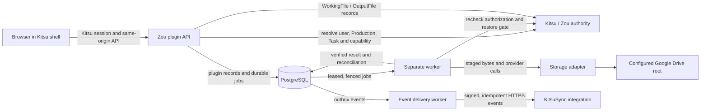

# VFX Files runtime architecture

This diagram describes the implementation checkpoint `bb732e3c3932f7488053e7e82ea5243d2358c121`. It is a source-level design map, not deployment approval or evidence of live Google Drive or Production behavior.

## Ownership boundaries

- Kitsu/Zou owns identity, Production membership, Task assignments, and native WorkingFile/OutputFile records.
- PostgreSQL stores plugin state, job leases, manifests, workflow history, and event outbox records.
- The separate Worker performs external storage operations after authorization and restore checks. A database success state alone is not proof that provider bytes were transferred.
- The storage adapter is constrained to the configured Production root. KitsuSync receives signed integration events and can provide an authorized-root contract; it is not the identity authority.

For publication blockers and evidence boundaries, see [`docs/oss/PUBLICATION_AUDIT.md`](../oss/PUBLICATION_AUDIT.md).
